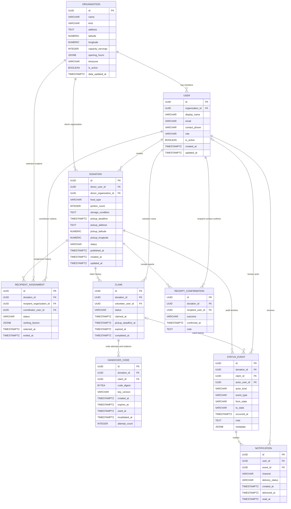

# Estafet Domain Model

- **Session:** 2 — Domain Model, Lifecycle and API Contract
- **Status:** Draft proposal; awaiting explicit review and approval from Members A, B and C.
- **Scope:** Data model only. No ORM, migrations, authentication or workflow endpoints are implemented in this session.

## 1. Design boundaries

The SRS is the source of behavior. This model covers its nine core records: `User`, `Organization`, `Donation`, `RecipientAssignment`, `Claim`, `HandoverCode`, `StatusEvent`, `Notification`, and `ReceiptConfirmation`. It keeps the donation lifecycle, recipient assignment, and volunteer claim as separate concepts.

The model is a proposal, not a record of team agreement. Decisions marked **proposed demo default** in `docs/decisions/` must be reviewed before they become policy or are encoded in migrations. The current backend has only health routes and `asyncpg`; no domain models or migrations exist. SQLAlchemy/Alembic work is deferred until the model is approved.

### Common storage conventions

- Primary keys and foreign keys: PostgreSQL `UUID`; generate identifiers in the application or with a database UUID function selected in implementation.
- Times: `TIMESTAMPTZ`, stored and compared in UTC; serialize as ISO 8601 UTC (`Z`). Preserve IANA timezone identifiers for organization opening hours and UI display.
- Money is out of scope. Portion and capacity values use positive integers under the proposed `serving` unit; see [ADR-001](decisions/ADR-001-portion-and-capacity-unit.md).
- Coordinates: `NUMERIC(9,6)` latitude/longitude in WGS-84; both coordinates are null or both are present. A missing coordinate is incomplete ranking data, not a zero distance.
- Enumerated states are proposed as `VARCHAR` plus named `CHECK` constraints (rather than PostgreSQL native enums) to make early state changes migration-manageable. All writes still go through the backend transition service.
- Workflow rows are not hard-deleted. Foreign keys use `ON DELETE RESTRICT`; deactivate reference records and retain the audit history. Retention and real-person data are not approved for the hackathon dataset.
- Store synthetic records only. Minimize personal contact data; role-based access and retention policy remain to be agreed.

## 2. ERD



`||--o{` indicates one-to-many history; partial unique indexes below restrict which history row may be current. `HANDOVER_CODE` is tied to a claim and repeats `donation_id` for efficient audit lookup; a composite foreign key `(claim_id, donation_id)` must ensure that the code and claim belong to the same donation.

## 3. Entity fields and semantics

| Entity | Proposed fields and PostgreSQL types | Meaning / ownership |
|---|---|---|
| `User` | `id UUID`; `organization_id UUID NULL`; `display_name VARCHAR(120)`; `email VARCHAR(320) NULL`; `contact_phone VARCHAR(32) NULL`; `role VARCHAR(24)`; `is_active BOOLEAN`; `created_at`, `updated_at TIMESTAMPTZ` | An application participant. Roles: `DONOR`, `COORDINATOR`, `VOLUNTEER`, `RECIPIENT_CONTACT`, `ADMIN`. A user has at most one organization in this MVP; an administrator may have none. Authentication credentials and role enforcement are Session 3, not part of this implementation. |
| `Organization` | `id UUID`; `name VARCHAR(160)`; `kind VARCHAR(24)`; `address TEXT`; `latitude`, `longitude NUMERIC(9,6) NULL`; `capacity_servings INTEGER NULL`; `opening_hours JSONB NULL`; `timezone VARCHAR(64)`; `is_active BOOLEAN`; `data_updated_at TIMESTAMPTZ`; `created_at`, `updated_at TIMESTAMPTZ` | Donor business, recipient organization, or the pilot community group. Opening hours are local wall-clock intervals interpreted in `timezone`; the JSON shape is documented in the API contract. Capacity is null when unknown, never treated as zero. |
| `Donation` | `id UUID`; `donor_user_id UUID`; `donor_organization_id UUID`; `food_type VARCHAR(160)`; `portion_count INTEGER NULL`; `storage_condition TEXT NULL`; `pickup_deadline TIMESTAMPTZ NULL`; `pickup_address TEXT NULL`; `pickup_latitude`, `pickup_longitude NUMERIC(9,6) NULL`; `status VARCHAR(32)`; `published_at TIMESTAMPTZ NULL`; `created_at`, `updated_at TIMESTAMPTZ` | One donor listing. Fields may be incomplete while `DRAFT`; publish requires the SRS-required data. A published pickup deadline is immutable in this draft contract; changing it later requires an explicitly approved transition. |
| `RecipientAssignment` | `id UUID`; `donation_id UUID`; `recipient_organization_id UUID`; `coordinator_user_id UUID`; `status VARCHAR(16)`; `ranking_factors JSONB NULL`; `selected_at TIMESTAMPTZ`; `ended_at TIMESTAMPTZ NULL` | A coordinator's selection, with history. `ACTIVE` means current; `SUPERSEDED` and `CANCELLED` are terminal history states. At most one assignment is active per donation. Ranking data is an explanatory snapshot, not an automatic decision. |
| `Claim` | `id UUID`; `donation_id UUID`; `volunteer_user_id UUID`; `status VARCHAR(16)`; `claimed_at TIMESTAMPTZ`; `pickup_deadline_at TIMESTAMPTZ`; `expired_at`, `completed_at TIMESTAMPTZ NULL` | One volunteer's pickup ownership. `pickup_deadline_at` snapshots the published donation deadline so expiration is auditable. Only `ACTIVE` claims lock the donation; historical claims remain queryable. |
| `HandoverCode` | `id UUID`; `donation_id UUID`; `claim_id UUID`; `code_digest BYTEA`; `key_version VARCHAR(32)`; `created_at`, `expires_at TIMESTAMPTZ`; `used_at`, `invalidated_at TIMESTAMPTZ NULL`; `attempt_count INTEGER` | Single-claim code record. Store a keyed non-reversible digest, not the raw code; keep the key outside the database. Issuance/rotation invalidates the prior code. Raw code is returned only to the donor during issuance and is never logged. The exact digest and retry policy are pending ADR-005. |
| `StatusEvent` | `id UUID`; `donation_id UUID`; `claim_id UUID NULL`; `actor_user_id UUID NULL`; `actor_kind VARCHAR(8)`; `event_type VARCHAR(48)`; `from_state`, `to_state VARCHAR(32) NULL`; `occurred_at TIMESTAMPTZ`; `note TEXT NULL`; `metadata JSONB NULL` | Append-only audit event. `actor_kind` is `USER` or `SYSTEM`; a system event has no `actor_user_id`. `note`/metadata must not contain OTPs, passwords, secrets or unnecessary personal data. |
| `Notification` | `id UUID`; `user_id UUID`; `event_id UUID`; `channel VARCHAR(16)`; `delivery_status VARCHAR(16)`; `created_at TIMESTAMPTZ`; `delivered_at`, `read_at TIMESTAMPTZ NULL` | A recipient-specific notification/outbox record for an event. Persist workflow state and notification intent in one transaction; delivery failure updates this record and must not roll back the domain event. |
| `ReceiptConfirmation` | `id UUID`; `donation_id UUID`; `recipient_user_id UUID`; `outcome VARCHAR(16)`; `confirmed_at TIMESTAMPTZ`; `note TEXT NULL` | Recipient's receipt report. `RECEIVED` completes the relay; `DISCREPANCY` routes to exception review and is not success. Multiple discrepancy reports may be retained; at most one successful `RECEIVED` record is allowed. |

### Controlled values

- Organization kind: `DONOR_BUSINESS`, `RECIPIENT`, `COMMUNITY_GROUP`.
- User role: `DONOR`, `COORDINATOR`, `VOLUNTEER`, `RECIPIENT_CONTACT`, `ADMIN`.
- Assignment status: `ACTIVE`, `SUPERSEDED`, `CANCELLED`; Donation and Claim states are defined in `docs/03-donation-state-machine.md`.
- Handover code state is derived from timestamps (`ACTIVE`, `USED`, `EXPIRED`, `INVALIDATED`); it is not independently mutable.
- Event actor kind: `USER`, `SYSTEM`. Event types include `DONATION_PUBLISHED`, `RECIPIENT_SELECTED`, `RECIPIENT_REOPENED`, `CLAIM_CREATED`, `CLAIM_EXPIRED`, `HANDOVER_VERIFIED`, `REASSIGNMENT_RESOLVED`, `RECEIPT_CONFIRMED`, `DISCREPANCY_REPORTED`, `DONATION_CANCELLED`, `DONATION_EXPIRED`, and `DONATION_CLOSED`.
- Notification channel: `IN_APP` and, if enabled later, `WEB_PUSH`; delivery status: `PENDING`, `DELIVERED`, `FAILED`, `SKIPPED`.
- Receipt outcome: `RECEIVED`, `DISCREPANCY`.

### Proposed JSON shapes

Opening hours use an organization-local timezone and an array of weekday intervals, for example:

```json
{
  "monday": [{"opens": "09:00", "closes": "17:00"}],
  "tuesday": [{"opens": "09:00", "closes": "17:00"}],
  "wednesday": [{"opens": "09:00", "closes": "17:00"}],
  "thursday": [{"opens": "09:00", "closes": "17:00"}],
  "friday": [{"opens": "09:00", "closes": "17:00"}],
  "saturday": [],
  "sunday": []
}
```

The implementation must validate all seven weekday keys and local time intervals. Overnight intervals and holiday exceptions remain unspecified. `ranking_factors` records the factor inputs and explanations used at selection time; its schema is versioned in the ranking workstream, not used to authorize selection.

## 4. Relationships and invariants

1. An organization has zero or more users and donor donations. `User.organization_id` may be null for an administrator.
2. A donation belongs to one donor user and one donor organization. The donor user must be authorized for that organization; enforce this in the service layer.
3. A donation has zero or more recipient-assignment history rows, but at most one `ACTIVE` assignment at a time. Selection is explicit coordinator action. No recipient is auto-confirmed.
4. A donation has zero or more claim-history rows, but at most one `ACTIVE` claim at a time. Claim creation runs in a transaction and the database partial unique index is the final concurrency guard.
5. A handover code belongs to exactly one claim and the same donation. A claim may have rotated/revoked code records for audit, but at most one unconsumed, non-revoked code is current. Code success, claim completion, donation transition, code consumption and status event commit atomically.
6. A status event belongs to one donation and optionally one claim. Events are append-only; do not update/delete them to rewrite history.
7. A notification belongs to one user and one event. A notification failure cannot undo the event.
8. A receipt confirmation belongs to one donation and one recipient contact. The contact's organization must match the current assignment at confirmation time; enforce in the service layer and record the actor.
9. A donation may have no more than one successful receipt confirmation. A discrepancy is not a successful receipt.
10. The donation's `RECEIVED` state is entered only when a `RECEIVED` confirmation is committed; successful donor handover alone is not completion.

## 5. Constraints and indexes

### Database constraints

- `users.role` and each status/outcome/channel column have `CHECK` constraints over the documented values. Role-to-organization-kind rules are enforced by authorization/domain services.
- `portion_count > 0` when non-null; `capacity_servings > 0` when non-null; `attempt_count >= 0`.
- Latitude is in `[-90, 90]`, longitude in `[-180, 180]`; latitude and longitude must be both null or both non-null.
- A non-draft donation must have food type, positive portion count, storage condition, future-at-publication deadline, and a sufficiently specific pickup address. Deadline-vs-current-time is validated at publication in the service; a `CHECK` constraint must not depend on a changing `now()` value.
- `published_at` is non-null for every state after `DRAFT`. State/timestamp consistency (for example, `expired_at` on `EXPIRED`) is enforced by transition services and tests.
- All foreign keys use `ON DELETE RESTRICT`. Do not cascade-delete an audit trail.
- Unique case-insensitive email for non-null email addresses, implemented with a unique index on `lower(email)` rather than requiring a PostgreSQL extension.
- Composite FK for `(handover_codes.claim_id, handover_codes.donation_id)` to `claims(id, donation_id)`.
- Partial unique index on `recipient_assignments(donation_id) WHERE status = 'ACTIVE'`.
- Partial unique index on `claims(donation_id) WHERE status = 'ACTIVE'` (NFR-004 / AT-04).
- Partial unique index on `handover_codes(claim_id) WHERE used_at IS NULL AND invalidated_at IS NULL`; an expired code must be invalidated before replacement.
- Partial unique index on `receipt_confirmations(donation_id) WHERE outcome = 'RECEIVED'`.
- Unique `(user_id, event_id, channel)` on notifications to prevent duplicate delivery intent for the same event/channel.

### Query indexes

- `donations(status, pickup_deadline)` for open, deadline and reassignment views; `donations(donor_user_id, created_at DESC)` for donor history.
- `organizations(kind, is_active)` for recipient lookup; coordinates are indexed only if a chosen query strategy requires it.
- `recipient_assignments(recipient_organization_id, selected_at DESC)` for recipient schedule/history.
- `claims(volunteer_user_id, status, claimed_at DESC)` and `claims(status, pickup_deadline_at)` for volunteer history and expiration scans.
- `handover_codes(claim_id, created_at DESC)` for code rotation/audit.
- `status_events(donation_id, occurred_at, id)` for stable timeline pagination; `status_events(actor_user_id, occurred_at)` for audit lookup.
- `notifications(user_id, read_at, created_at DESC)` for the in-app inbox.
- `receipt_confirmations(donation_id, confirmed_at DESC)` for receipt history.

## 6. Transaction boundaries

- **Publish:** lock/validate the draft, verify required fields and future deadline, set `OPEN`/`published_at`, append event, and insert notification intents atomically.
- **Select recipient:** lock the donation, verify `OPEN`, verify actor and recipient eligibility data, create the active assignment, set `RECIPIENT_SELECTED`, append event and notification intents atomically.
- **Claim:** lock donation (or use an equivalent serializable/unique-index-safe strategy), verify `RECIPIENT_SELECTED`, assignment active, and deadline not passed; insert `ACTIVE` claim and event/notification intents atomically. Translate the unique-index conflict into `409 ACTIVE_CLAIM_EXISTS`.
- **Verify handover:** lock donation, claim and current code; validate code and policy using server UTC; consume code; complete claim; transition donation; append event and notification intent in one transaction. Expiration uses the same lock/guard so it cannot win after successful verification.
- **Expire claim:** select overdue active claims with a locking strategy, recheck no successful handover, change claim to `EXPIRED`, donation to `REASSIGNMENT_REQUIRED`, append event and notification intent atomically. The worker must be idempotent.
- **Receipt:** authorize the currently assigned recipient contact; insert receipt record and event; enter `RECEIVED` only for outcome `RECEIVED`. A `DISCREPANCY` moves the donation to `EXCEPTION_REVIEW` without false completion.

## 7. Decisions and approval gate

Open decisions are recorded separately in [`docs/decisions/`](decisions/README.md). The current defaults are proposals only. In particular, the portion unit, deadline boundary, retry/reassignment semantics, ranking policy, OTP policy, recipient-data ownership/freshness, and AT-10 scope require team review.

**No SQLAlchemy model, Alembic configuration, migration, or domain code is added in Session 2 until all three members approve this model and the API contract.** After approval, Member A owns the first model/migration draft, Member B reviews API-to-screen fit, and Member C reviews invariants and derives contract tests.

## 8. SRS coverage

This proposal maps the core records to SRS §9.1, FR-001–FR-033, BR-01–BR-10, relevant NFRs, and AT-01–AT-09. `docs/requirement-traceability.md` records the full FR/NFR/BR/AT mapping and current implementation status.