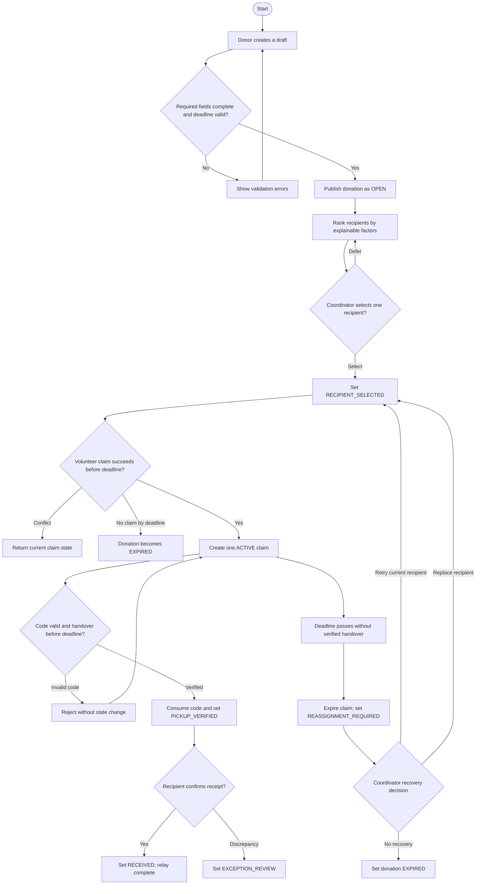
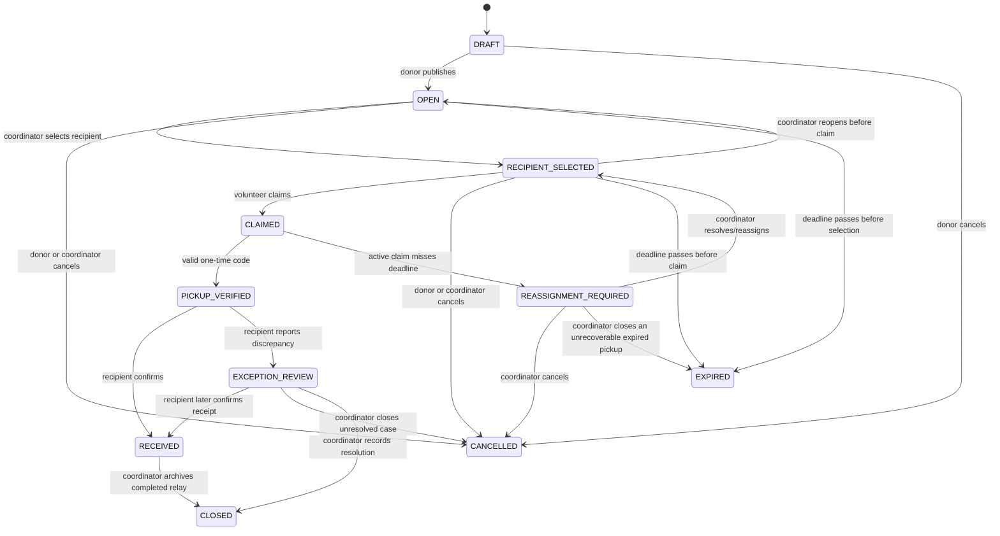
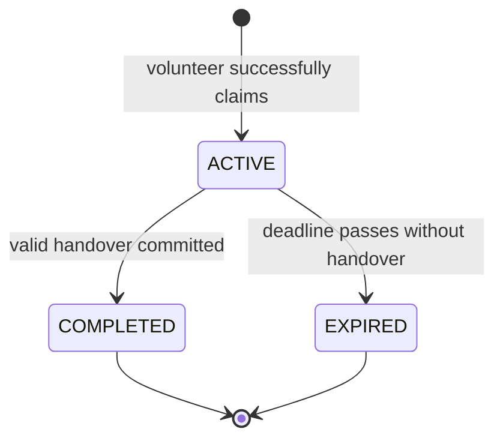

# Donation and Claim State Machines

- **Session:** 2 — Domain Model, Lifecycle and API Contract
- **Status:** Draft proposal; awaiting explicit approval from Members A, B and C.
- **Source:** SRS §§6–7, Use Cases UC-01–UC-06 and AT-01–AT-08.

The state names below are canonical API/database values. SRS prose such as “Recipient Selected” maps to `RECIPIENT_SELECTED`; the earlier roadmap's illustrative `ASSIGNED` is not a second state. Donation, recipient assignment and claim state are separate. The frontend cannot perform a transition by changing a displayed status.

## End-to-end relay flow

This flow shows the successful relay and the overdue-claim recovery path. It is a proposed behavior flow, not an implementation claim; the open policy choices remain in `docs/decisions/`.

## 1. Donation lifecycle

`CANCELLED`, `EXPIRED`, and `CLOSED` are terminal. `REASSIGNMENT_REQUIRED` is an actionable coordinator queue state, not proof that the donation was collected or cancelled. `CLOSED` is an administrative archive state from the SRS proposal; it is not needed to demonstrate the P0 relay and must not replace a `RECEIVED` confirmation.

## 2. Donation transition rules

| From → To | Allowed actor | Preconditions | Atomic effects / audit evidence | SRS trace |
|---|---|---|---|---|
| `DRAFT → OPEN` | Owning donor | Required food, positive portions, declared storage condition, pickup address/location and future deadline validate. | Set `published_at`; append `DONATION_PUBLISHED`; create notification intents. | FR-004–008, UC-01, AT-01/02 |
| `DRAFT → CANCELLED` | Owning donor; coordinator for operational cleanup | Draft is not published. | Record cancellation event and actor. | SRS proposed state list |
| `OPEN → RECIPIENT_SELECTED` | Coordinator | Donation is open; chosen recipient is active and has the data needed for the coordinator decision; no other current assignment. | Create one active `RecipientAssignment`; record coordinator and selection time; append event and notification intents. | FR-010–013, BR-01/02, UC-02, AT-03 |
| `OPEN → CANCELLED` | Owning donor or coordinator | No active claim (this state has none). | Append cancellation event with actor/reason. | SRS proposed state list |
| `OPEN → EXPIRED` | Deadline monitor (system) | Current time is strictly after the pickup deadline; there is no active claim. | Set terminal state; append idempotent expiration event. | SRS proposed state list; FR-019/020 |
| `RECIPIENT_SELECTED → CLAIMED` | Eligible volunteer | Current assignment exists; deadline has not passed; no active claim. | Insert `ACTIVE` claim with deadline snapshot; append claim/donation events and notification intents in the same transaction. | FR-015–018, BR-03, UC-03, AT-04 |
| `RECIPIENT_SELECTED → OPEN` | Coordinator | No active claim. Coordinator explicitly reopens rather than silently changing a confirmed recipient. | End current assignment as `SUPERSEDED` or `CANCELLED`; append event. A future recipient selection creates a new assignment row. | SRS proposed state list; FR-012/013 |
| `RECIPIENT_SELECTED → CANCELLED` | Owning donor or coordinator | No active claim. | Append cancellation event and reason. | SRS proposed state list |
| `RECIPIENT_SELECTED → EXPIRED` | Deadline monitor (system) | Current time is strictly after pickup deadline; no active claim. | Set terminal state; append idempotent expiration event. | SRS proposed state list; FR-019/020 |
| `CLAIMED → PICKUP_VERIFIED` | Volunteer submits code; system authorizes | Claim is active; supplied code matches current digest, is unexpired and unused; verification is committed at or before pickup deadline. | Consume code, set claim `COMPLETED`, record `verified_at` event, set donation state, and create notification intent atomically. | FR-022–025, BR-04/05, UC-04, AT-05 |
| `CLAIMED → REASSIGNMENT_REQUIRED` | Deadline monitor (system) | Current time is strictly after the pickup deadline; claim remains active; no handover has committed. | Set claim `EXPIRED`; preserve assignment history; set donation state; append event and coordinator notification intent atomically. | FR-019–021, BR-07, UC-06, AT-07 |
| `PICKUP_VERIFIED → RECEIVED` | Contact of the currently assigned recipient | Handover is verified; actor belongs to the assigned recipient organization; actual receipt is confirmed. | Insert `RECEIVED` confirmation; append event and notification intents. | FR-026/027, BR-06, UC-05, AT-06 |
| `PICKUP_VERIFIED → EXCEPTION_REVIEW` | Contact of the currently assigned recipient | Handover is verified; recipient reports a missing/inconsistent delivery rather than confirming receipt. | Insert `DISCREPANCY` confirmation and follow-up event; never report success. | FR-028 P1; UC-05 alternate path |
| `REASSIGNMENT_REQUIRED → RECIPIENT_SELECTED` | Coordinator | Expired claim is no longer active; deadline/recovery is still actionable; coordinator chooses `RETRY_CURRENT` or `REPLACE_RECIPIENT`. | For retry, reactivate/retain the same current assignment; for replacement, end it and create one new active assignment. Append explicit resolution event; no claim is created until a volunteer claims again. | FR-020/021, BR-01/07, UC-06 |
| `REASSIGNMENT_REQUIRED → CANCELLED` | Coordinator | Coordinator decides recovery will not proceed; reason recorded. | End active assignment if present and record resolution. | SRS proposed state list |
| `REASSIGNMENT_REQUIRED → EXPIRED` | Coordinator | Pickup deadline has passed and coordinator records that recovery is no longer feasible. | Record terminal disposition; no claim may be created. | SRS proposed state list |
| `EXCEPTION_REVIEW → RECEIVED` | Contact of assigned recipient | Delivery is subsequently confirmed; valid receipt confirmation is recorded. | Add successful receipt record and event; transition is not available to coordinator-only action. | FR-026–028 |
| `EXCEPTION_REVIEW → CANCELLED` | Coordinator | Manual follow-up concludes delivery cannot be confirmed; a reason is recorded. | Record resolution without marking received. | SRS proposed state list |
| `EXCEPTION_REVIEW → CLOSED` | Coordinator | Manual outcome is documented and follow-up is complete; do not infer successful receipt. | Append archive/resolution event. | SRS proposed state list |
| `RECEIVED → CLOSED` | Coordinator | Successful recipient confirmation exists. | Archive only; preserve receipt and audit events. | SRS proposed state list |

No transition may be applied by directly patching `status`. Unsupported or out-of-order operations return a conflict and do not write partial events.

## 3. Claim lifecycle (separate from donation state)

| From → To | Actor | Preconditions | Effects |
|---|---|---|---|
| no claim → `ACTIVE` | Volunteer | Donation is `RECIPIENT_SELECTED`, assignment is current, deadline is not passed, and no other active claim exists. | Set `claimed_at` and immutable `pickup_deadline_at` snapshot; database partial unique index enforces one active claim. |
| `ACTIVE → COMPLETED` | System, on volunteer's valid code submission | Code is valid, unexpired and unused; transaction commits at/before the deadline. | Set `completed_at`; consume code; donation becomes `PICKUP_VERIFIED`. |
| `ACTIVE → EXPIRED` | Deadline monitor | Time is strictly after deadline and handover has not committed. | Set `expired_at`; donation becomes `REASSIGNMENT_REQUIRED`. |

There is no volunteer self-release/cancel operation in the SRS MVP. Adding one would require an explicit team decision and a new transition. A cancelled donation is only allowed from states without an active claim in this proposal; therefore it cannot strand an `ACTIVE` claim.

## 4. Recipient assignment lifecycle

Assignments have `ACTIVE`, `SUPERSEDED`, or `CANCELLED` status. A current assignment may become `SUPERSEDED` only when a coordinator explicitly replaces it; it becomes `CANCELLED` when its donation is cancelled. Historical rows are never reactivated. At most one row per donation has `ACTIVE` status. Claim expiry does **not** itself change the assignment; see [ADR-003](decisions/ADR-003-reassignment-semantics.md).

## 5. Handover-code lifecycle and race safety

A code is issued only for an active claim. It is usable only while unexpired, unconsumed and not invalidated. Successful verification consumes it once. Rotation invalidates the previous code before issuing a replacement. Invalid attempts do not change donation/claim state; retry policy is pending [ADR-005](decisions/ADR-005-one-time-code-policy.md).

Both code verification and expiration must lock/recheck the same donation and active claim inside a transaction. Whichever commits first determines the outcome: after successful verification, the expiration worker must no-op; after expiration, code verification must fail. Exact deadline boundary is a proposal in [ADR-002](decisions/ADR-002-deadline-semantics.md), awaiting approval.

## 6. Business rules and decision status

- One donation has at most one current recipient assignment; no splitting or multiple recipients (BR-01).
- Only a coordinator confirms a recipient (BR-02); ranking never auto-assigns (BR-09/10).
- A donation has at most one active claim (BR-03 / NFR-004).
- Donor handover is not verified without valid single-use code (BR-04/05).
- Donation is not `RECEIVED` before the designated recipient confirms (BR-06).
- Deadline expiry requires no committed handover (BR-07).
- Food/storage details are donor declarations, not a safety certification (BR-08).
- This document's transition table is a draft for review, not evidence that all three members or a pilot coordinator approved the demo defaults. See [`docs/decisions/`](decisions/README.md).

## 7. Traceability

Transition-specific SRS coverage is listed in `docs/requirement-traceability.md`. AT-01–AT-10 are planned acceptance tests, not run by this documentation-only session.