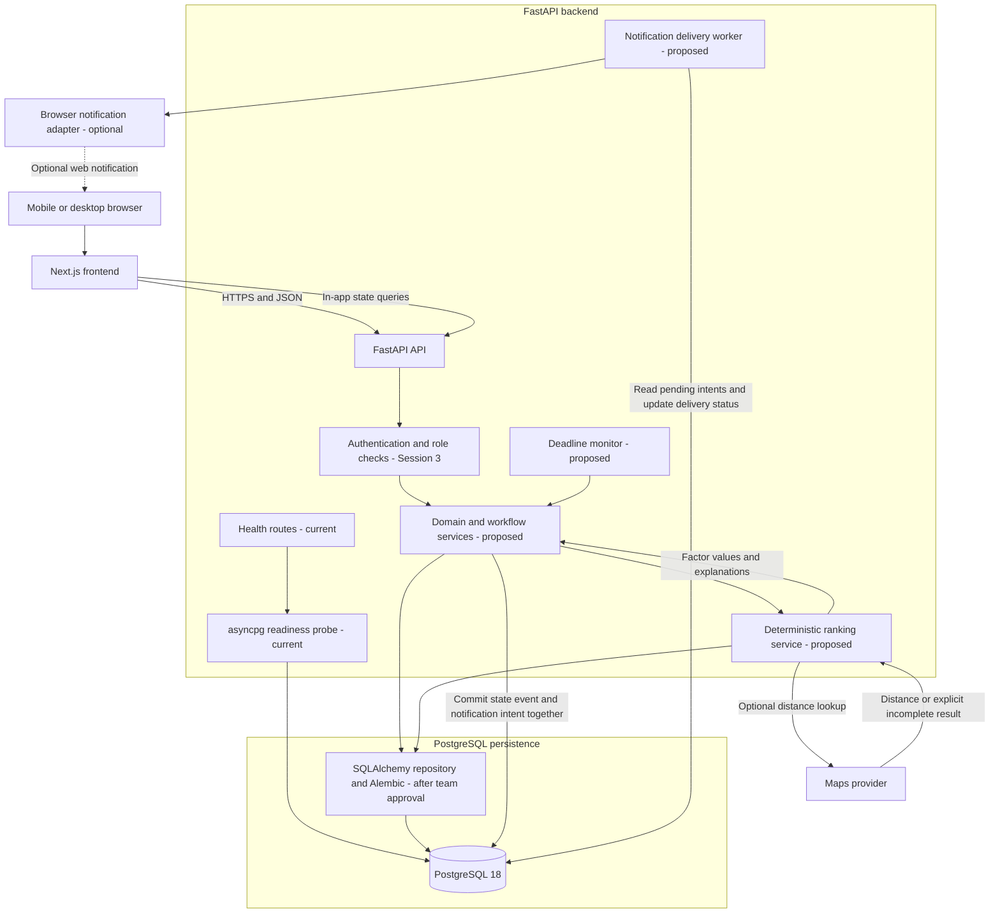

# Estafet REST API Contract

- **Session:** 2 — Domain Model, Lifecycle and API Contract
- **Status:** Draft proposal; pending approval from Members A, B and C.
- **Base path:** `/api/v1`
- **Media type:** JSON (`application/json`); errors use `application/problem+json`.
- **Scope:** Contract only. Existing code exposes health endpoints at `/`, `/health/live`, and `/health/ready`; none of the application routes below are implemented in Session 2.

## 1. Contract principles

- FastAPI is authoritative for identity, role checks, validation, state transitions, deadlines, claim locking, code validation, and persisted results.
- The authenticated user is derived from the future authentication context; clients must not supply trusted `user_id`, actor role, current state, timestamps, ranking score, code digest, or delivery status.
- All timestamps are UTC ISO 8601 strings ending in `Z`; coordinates are WGS-84 decimal degrees.
- Success bodies return resource representations directly (no inconsistent per-route envelope). Collections return `{ "items": [...], "next_cursor": null }`.
- Mutations are transaction-backed and return the committed state. A notification/map failure does not imply that the core state mutation failed or gets rolled back.
- This document specifies future authorization requirements but does not implement authentication (Session 3).

### Proposed component architecture

The diagram distinguishes existing infrastructure from proposed domain components. The current API has health routes and an `asyncpg` readiness probe only. Authentication, domain routes, ORM/migrations, ranking, expiry and notification delivery are planned; they are not implemented by this Session 2 documentation.



The database remains authoritative. Ranking/map failure yields an explicit incomplete result; notification delivery failure updates delivery status but does not roll back a committed workflow event.

## 2. Resource schemas

The examples omit fields not relevant to the operation. UUIDs are strings in JSON.

### Donation

```json
{
  "id": "8bded4b2-1a95-4f44-b94f-8323a2726515",
  "donor_organization_id": "fdd71e07-c9d4-4c68-a03c-51e21dc7db0a",
  "food_type": "prepared meals",
  "portion_count": 24,
  "storage_condition": "chilled; donor-declared",
  "pickup_deadline": "2026-11-14T11:00:00Z",
  "pickup_location": {
    "address": "Synthetic location, Pilot City",
    "latitude": -6.200000,
    "longitude": 106.816666
  },
  "status": "OPEN",
  "published_at": "2026-11-13T10:00:00Z",
  "created_at": "2026-11-13T09:45:00Z",
  "updated_at": "2026-11-13T10:00:00Z"
}
```

`portion_count` is based on the proposed serving unit in ADR-001, pending approval. Drafts may omit required publication fields. Published representations must include validated required fields. Coordinates may be absent only when location data is marked incomplete; the API must not fabricate distance.

### Recipient ranking

```json
{
  "donation_id": "8bded4b2-1a95-4f44-b94f-8323a2726515",
  "generated_at": "2026-11-13T10:01:00Z",
  "complete": false,
  "items": [
    {
      "recipient_organization_id": "fdd71e07-c9d4-4c68-a03c-51e21dc7db0a",
      "rank": 1,
      "distance_km": null,
      "distance_status": "UNAVAILABLE",
      "capacity_suitable": true,
      "opening_hours_suitable": true,
      "explanations": ["Distance is unavailable; no distance score was fabricated."],
      "score": null
    }
  ]
}
```

Factor fields are explicit: `distance_status` is `AVAILABLE`, `ESTIMATED`, or `UNAVAILABLE`; capacity/opening suitability is `true`, `false`, or `null` (unknown). `complete=false` signals missing ranking inputs. A coordinator may defer selection or make a documented manual decision under the agreed policy. `score` is null until the ranking formula/normalization in ADR-004 is approved; a client cannot submit or override it.

### Assignment and claim

An assignment response includes `id`, `donation_id`, `recipient_organization_id`, `coordinator_user_id`, `status`, `selected_at`, and the server-generated `ranking_factors` snapshot (when available). A claim response includes `id`, `donation_id`, `volunteer_user_id`, `status`, `claimed_at`, and `pickup_deadline_at`. Neither response exposes OTP material.

### Handover code and verification

The code-issuance response is the only response containing the raw code and is visible only to the authorized donor for the donation:

```json
{ "claim_id": "8bded4b2-1a95-4f44-b94f-8323a2726515", "code": "123456", "expires_at": "2026-11-13T10:10:00Z" }
```

This illustrative code is not a credential. The implementation must generate cryptographically random code material, return it only once over the authenticated API, never log/store it in plaintext, and persist only a keyed digest. If the response is lost, rotate/invalidate the prior code according to ADR-005; do not retrieve plaintext from storage.

A receipt response contains `id`, `donation_id`, `recipient_user_id`, `outcome` (`RECEIVED` or `DISCREPANCY`), `confirmed_at`, and optional note. `DISCREPANCY` is not success and does not set the donation to `RECEIVED`.

## 3. Endpoint contract

All protected routes assume a future authenticated principal. Roles in this table are required server-side; hiding a button is not authorization.

| Method and path | Allowed role | Request | Success | Behavior / principal errors |
|---|---|---|---|---|
| `POST /donations` | Donor | `CreateDonationDraftRequest` (partial fields allowed) | `201 Donation` | Create unpublished `DRAFT`; actor and donor organization come from principal. |
| `GET /donations` | Authenticated users, row-filtered | Query `status`, `cursor`, `limit` (default 20, max 100) | `200 Collection<Donation>` | Return only rows the principal may see. Unknown/invalid filters: `422`. |
| `GET /donations/{donation_id}` | Authorized donor, coordinator, assigned volunteer/recipient | None | `200 Donation` | `404` if absent or not visible under the privacy policy. |
| `PATCH /donations/{donation_id}` | Owning donor | `UpdateDonationDraftRequest` | `200 Donation` | Draft fields only; no direct status or actor fields. Non-draft edit: `409 INVALID_STATE_TRANSITION`. |
| `POST /donations/{donation_id}/publish` | Owning donor | No body | `200 Donation` | Validate complete required fields and future deadline; transition `DRAFT→OPEN`; append event/notification intents. Invalid field: `422`; stale state: `409`. |
| `GET /organizations/recipients` | Coordinator | Query `active`, `cursor`, `limit` | `200 Collection<RecipientSummary>` | Returns recipient data needed for coordinator ranking, with data freshness. |
| `GET /donations/{donation_id}/recipient-rankings` | Coordinator | Optional `receiving_window_start` (UTC) | `200 RecipientRankingResponse` | Deterministic and explainable; incomplete map/recipient inputs are reported, not fabricated. |
| `POST /donations/{donation_id}/recipient-assignment` | Coordinator | `{ "recipient_organization_id": UUID }` | `201 RecipientAssignment` | Explicit selection only; one current assignment. `409` if donation not open or already assigned; ranking snapshot is server-generated. |
| `POST /donations/{donation_id}/reassignment` | Coordinator | `ReassignmentRequest` (below) | `200 Donation` | Resolve queue by retrying current recipient, replacing it, or marking unrecoverable pickup expired. Must not create a claim. |
| `POST /donations/{donation_id}/claims` | Volunteer | Empty object | `201 Claim` | Atomically claim a `RECIPIENT_SELECTED` donation. `409 ACTIVE_CLAIM_EXISTS` if another wins; also conflict if deadline/state disallows claim. |
| `GET /claims/{claim_id}` | Claim volunteer, donor, coordinator, assigned recipient as permitted | None | `200 Claim` | Do not expose raw code or other users' contact details. |
| `POST /claims/{claim_id}/handover-code` | Donor who owns the donation | No body | `201 HandoverCodeIssueResponse` | Issue/rotate code for active claim; invalidate prior code; raw code returned once to donor only. Rate limit and expiry are policy-gated by ADR-005. |
| `POST /claims/{claim_id}/handover-verifications` | Volunteer who owns the claim | `{ "code": "string" }` | `200 { "claim": Claim, "donation": Donation }` | Consume valid current code exactly once and atomically complete claim/transition donation. Invalid, expired, reused or exhausted codes return generic `422 HANDOVER_CODE_REJECTED`, without revealing which check failed. |
| `GET /coordinator/reassignments` | Coordinator | Query `cursor`, `limit` | `200 Collection<Donation>` | Only `REASSIGNMENT_REQUIRED` donations, deadline and claim context included. |
| `POST /donations/{donation_id}/receipt-confirmations` | Contact in currently assigned recipient organization | `ReceiptConfirmationRequest` | `201 ReceiptConfirmation` | `RECEIVED` only after verified handover; `DISCREPANCY` creates exception event. Wrong actor/state: `403`/`409`. |
| `GET /donations/{donation_id}/events` | Authorized relay participant | Query `cursor`, `limit` | `200 Collection<StatusEvent>` | Stable chronological history; secrets excluded. |
| `GET /notifications` | Authenticated user | Query `unread`, `cursor`, `limit` | `200 Collection<Notification>` | Only caller's records; delivery state shown honestly. |
| `GET /coordinator/metrics` | Coordinator | Required UTC `from`, `to` | `200 MetricsResponse` | Claim rate, median time-to-claim, on-time pickup rate; return counts and denominators alongside ratios (FR-032). |

The deadline monitor/expiry worker is an internal scheduled service operation, not a public user endpoint. It must be idempotent and transactionally race-safe. Authentication/login routes are deliberately deferred to Session 3. Organization management is deferred to the later data-management session except for the read contract needed by ranking.

### Mutation request schemas

`CreateDonationDraftRequest` fields (all optional until publish; donor identity/organization are derived from the authenticated principal):

```json
{
  "food_type": "prepared meals",
  "portion_count": 24,
  "storage_condition": "chilled",
  "pickup_deadline": "2026-11-14T11:00:00Z",
  "pickup_location": {
    "address": "Synthetic location, Pilot City",
    "latitude": -6.2,
    "longitude": 106.816666
  }
}
```

The API derives the donor organization from the authenticated principal; the body cannot select another organization's records. If a donor may act for multiple organizations, Member B and the team must agree a server-authorized organization context before adding it to the contract.

`ReassignmentRequest`:

```json
{
  "action": "RETRY_CURRENT",
  "recipient_organization_id": null,
  "reason": "Coordinator confirmed the current recipient can still receive this donation."
}
```

`action` is `RETRY_CURRENT`, `REPLACE_RECIPIENT`, or `EXPIRE`. `recipient_organization_id` is required only for `REPLACE_RECIPIENT`; `reason` is required for `EXPIRE` and may be supplied for other actions. Only a coordinator can perform it. Exact semantics are pending ADR-003.

`ReceiptConfirmationRequest`:

```json
{ "outcome": "RECEIVED", "note": null }
```

`outcome` is `RECEIVED` or `DISCREPANCY`; note is optional, bounded, and must not contain unnecessary personal data. A `DISCREPANCY` body records the reported condition but never marks delivery complete.

`Organization.opening_hours` uses the shape in `docs/02-domain-model.md`, validated against its IANA timezone. API clients receive `data_updated_at`; unavailable distance is represented as `null` with an explicit status/reason.

## 4. Error convention

Use RFC 9457-style `application/problem+json` bodies with stable machine codes:

```json
{
  "type": "about:blank",
  "title": "Conflict",
  "status": 409,
  "detail": "This donation already has an active volunteer claim.",
  "instance": "/api/v1/donations/8bded4b2-1a95-4f44-b94f-8323a2726515/claims",
  "code": "ACTIVE_CLAIM_EXISTS",
  "errors": [],
  "request_id": "8bded4b2-1a95-4f44-b94f-8323a2726515"
}
```

The example UUID is illustrative. `type`, `title`, `status`, `detail`, `instance`, `code`, `errors`, and `request_id` are stable contract fields; `errors` contains field-level `{ "field": "portion_count", "code": "must_be_positive", "message": "Must be greater than zero." }` entries when useful. Never include SQL, stack traces, secrets, OTP values, or hidden-record details.

| HTTP | Use |
|---:|---|
| `400` | Malformed JSON or request syntax that cannot be represented as a field error. |
| `401` | No valid authenticated principal (after Session 3). |
| `403` | Authenticated principal lacks the required role/relationship. |
| `404` | Unknown resource or a resource the caller is not allowed to discover. |
| `409` | State/precondition/concurrency conflict: `INVALID_STATE_TRANSITION`, `ACTIVE_CLAIM_EXISTS`, `ASSIGNMENT_EXISTS`, `DEADLINE_PASSED`, `ALREADY_RECEIVED`. |
| `422` | Syntactically valid JSON with invalid fields/domain input; use generic `HANDOVER_CODE_REJECTED` for all code failures. |
| `429` | Rate/attempt limit reached; include `Retry-After` where applicable. |
| `503` | Required local service unavailable; never report success when a required persistence operation failed. Optional map/notification provider failure is instead reported as incomplete/failed auxiliary status after core commit. |

## 5. Pagination, idempotency and consistency

- Cursor pagination is opaque and stable for event timelines; `limit` is bounded 1–100. Default sort is `created_at`/`occurred_at` descending for lists, ascending for donation event timelines.
- Do not hard-delete via API. Cancellation is a workflow transition with an actor/event, not an HTTP delete.
- Claim, handover, receipt and assignment mutation requests must tolerate client retries. Before implementation, decide whether the general `Idempotency-Key` header is required; database state constraints remain authoritative even without it.
- Return the committed database state after every mutation. On `409`, include the caller-visible current state when authorization allows it.
- Status events and notification intents are persisted in the same transaction as the corresponding core state change; actual external delivery occurs afterward and cannot roll back the transaction.

## 6. Approval and implementation gate

This contract is documentation only and does not add route handlers, schemas, auth code, SQLAlchemy, or Alembic. Members A, B and C must review the role/resource visibility, request shapes, status names, error policy and seven ADR proposals. Only after explicit agreement should Member A implement initial SQLAlchemy models/migration, Member B validate the frontend request/response fit, and Member C turn the contract into tests. See `docs/requirement-traceability.md`.